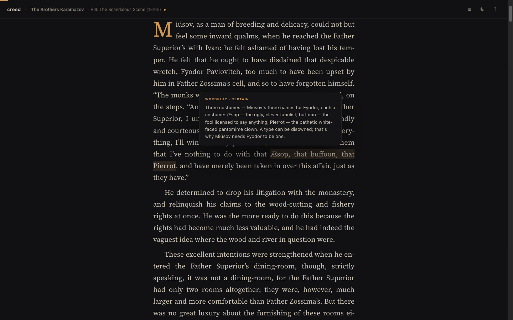

# creed

Long, difficult books with the notes built in. You read the real text;
a dotted line under a phrase opens a note on hover, a solid line opens a
full reference page, and each chapter ends with commentary. Built for
books that are hard to read alone — the first edition is
**The Brothers Karamazov** (Garnett translation, public domain), with
13 of 96 chapters annotated and more added in waves.



## The three parts

**Engine** — `src/` and `scripts/`. A React reader that renders any book:
inline notes, vocabulary cards, reference pages, spoiler gating,
commentary, table of contents, dark/paper themes, keyboard-driven. It
knows nothing about any specific book — everything it shows comes from
data files.

**Books** — `public/books/<id>/`. One directory per book: `book.json`
(metadata and pipeline rules), `manifest.json` (table of contents),
`chapters/`, `annotations/`, and the raw source text for provenance.
The Dostoevsky edition is `public/books/karamazov/`.

**App** — the Vite shell (`index.html`, `vite.config.ts`) that serves the
library page and all books. Builds to a static folder that deploys
anywhere; no server.

## Run

```sh
npm install
npm run dev        # http://localhost:5173
npm run build      # static site into dist/
npm run preview    # serve the build
```

## How a book is made

1. **Source** — a plain text (e.g. Project Gutenberg) goes into
   `public/books/<id>/source/`.
2. **Split** — `npm run split -- <id>` parses it into
   `chapters/*.json` (stable paragraph ids) and `manifest.json`.
   Importers are per-source; `scripts/split.py` understands the
   `PART / Book / Chapter` Gutenberg layout of classic novels.
3. **Annotate** — an AI wave writes `annotations/<chapter>.json`: notes
   anchored to exact sentences, translations of foreign passages,
   vocabulary, reference pages, commentary. The wave runs from
   `.zcode/workflows/wave.dwf.ts` (ZCode dynamic workflow) with
   `{ book: "<id>", count: 3 }`; the editorial rules and gold standard
   it follows live in the book's `book.json`.
4. **Gate** — `npm run validate` is the only quality gate: every anchor
   must exist, every quoted snippet must be a verbatim substring of the
   chapter text, ids unique, schema fields valid. Hallucinated quotes
   cannot pass. It also rewrites the ledgers: the annotations index,
   the per-book pipeline.md count, progress.log, and the
   `public/books.json` catalog the library page shows.

A book with no annotations yet still reads fine — the notes simply
appear chapter by chapter as waves land.

## Adding a book

Add one directory under `public/books/` — `book.json`, source, then
split and annotate as above. The engine needs no changes. Books without
internal parts use a single synthetic part in the manifest. See
`public/books/karamazov/book.json` for the shape.

## Keyboard

`j/k` scroll · `n/p` chapter · `t` contents · `a` clean mode ·
`s` spoilers · `m` dark/paper · `?` help

## Licenses

- Code (engine, scripts, workflow): **MIT** — see `LICENSE`
- Annotations and commentary: **CC BY 4.0** — see `LICENSE-CONTENT`
- Book texts: public domain where stated in each book's `book.json`;
  the Gutenberg source file keeps its license header
- Fonts: Source Serif 4 under the **SIL OFL 1.1** — see `src/fonts/OFL.txt`
